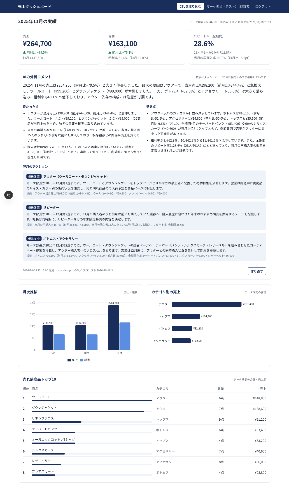
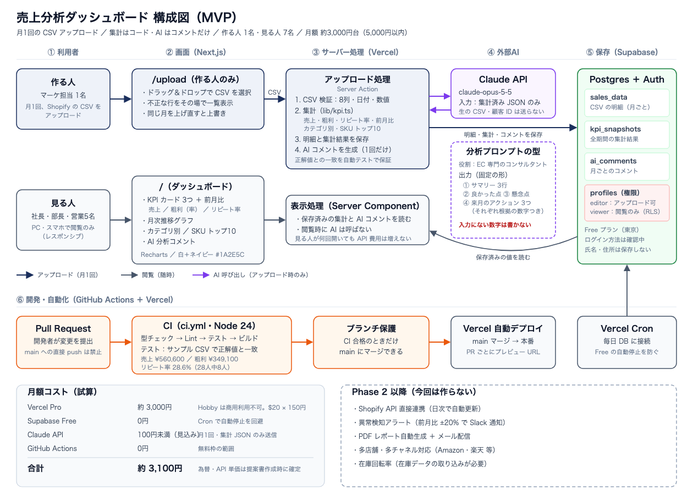

# AI搭載 売上分析ダッシュボード

Shopifyの売上CSV（原価を加えた8列の形式）をアップロードするだけで、売上・粗利・リピート率のダッシュボードと、AIによる分析コメント（今月の要約と翌月のアクション）ができるWebアプリです。

AIエンジニア講座の模擬案件8（アパレルECのマーケティング担当者からの依頼）として、ヒアリングから設計・実装・テストまで行いました。



## 解決したい課題

| 現在 | 導入後 |
|---|---|
| 毎月、CSVをExcelで整形し、グラフとコメントを作るのに約3時間 | 8列にそろえたCSVを入れるだけ。報告の作業は約30分（目標） |
| 手作業の集計による転記ミスの心配 | 集計はプログラムが行い、正解の数字との一致を自動テストで保証 |
| 翌月の打ち手が感覚で決まりがち | AIが数字の根拠つきでアクションを提案 |

## 設計で大事にしたこと

**1. 数字はAIに計算させない**
集計はすべてコード（`src/lib/kpi.ts`）が行います。AIには集計済み・整形済みの数字（`"¥264,700"` `"+79.5%"`）だけを渡し、そのまま引用させます。AIの出力に含まれる数字が入力に存在するかをコードで照合し（`src/lib/analysis/verify.ts`）、合わなければ問題を伝えて1回だけ作り直します。それでも合わなければ「要確認」と表示します。

**2. 1行でも誤りがあれば取り込まない**
意味が変わらない表記の違い（全角数字・空白・「¥」とカンマ・日付の区切り・Excelで保存し直したShift_JIS）は自動で補正し、補正した箇所を一覧で見せます。意味があいまいなもの（「アウタ」のような表記ゆれ、2月30日、負の数）は推測で直さず、行番号と理由を示して止めます。正常な行だけを取り込むと、合計がExcelとずれるためです。

**3. 見る人と作る人を分ける**
データを入れられるのは担当者（editor）だけで、社長・部長・営業（viewer）は閲覧のみです。画面での出し分けに加えて、SupabaseのRLS（行単位の閲覧制限）でもデータベース側で制限しています。

**4. AIはアップロード時に1回だけ呼ぶ**
コメントは保存して表示するので、見る人が何回開いてもAPIの費用は増えません。月額は約3,100円の見込みです（予算5,000円以内）。

## 構成



| 役割 | 技術 |
|---|---|
| 画面・サーバー | Next.js 16（App Router・Server Actions）、Tailwind CSS 4、Recharts 3 |
| データベース・ログイン | Supabase（Postgres・Auth・RLS）、東京リージョン |
| AI | Claude API（`claude-opus-5-5`、Structured Outputsで出力の形を固定） |
| CI/CD | GitHub Actions（型チェック・Lint・テスト・スキーマ検証・ビルド → テスト合格後に本番デプロイ）、Vercel |

## テスト

```bash
npm test               # 集計の正解値・CSVの検証とクリーニング・AI分析のSnapshot（25件）
npm run verify:schema  # 組み込みPostgresでスキーマと権限を検証（11項目）
npm run eval:analysis  # 本物のClaudeでAI分析を評価（費用がかかるため手動のみ）
```

- **集計**：サンプルCSV（`tests/fixtures/sample-sales.csv`）で、月次の売上・粗利、カテゴリ別売上、リピート率（28人中8人＝28.6%）が正解値と完全一致すること
- **AI分析のSnapshot**：AIの出力は毎回変わるため、「AIに渡す入力とプロンプト」と「記録した応答の検査結果」をSnapshotにしています。集計やプロンプトを変えると、AIに渡る内容の差分がPull Requestで見えます
- **本物のAIの評価**：数値照合の違反0件／形（総括200字以内・良かった点3・懸念点2・アクション3）／「冬物アウターが牽引」を拾う／翌月のアクションがアウター・リピーターに触れる、の4項目

## CI/CD

- Pull Request と main への push で `.github/workflows/ci.yml` が動きます
- ブランチ保護でCIの合格を必須にし、mainへの直接pushは禁止します
- 本番へのデプロイは、mainでテストに合格した後に、公式のVercel CLIで行います。Vercelの「mainへのマージで自動デプロイ」は `vercel.json` で止めてあり、本番に出る道はこのジョブだけです。Pull Requestごとのプレビューは、VercelのGitHub連携のままです

## 動かし方

```bash
npm install
cp .env.example .env.local   # Supabase と Claude のキーを書き込む
```

1. Supabaseで新しいプロジェクトを作り、SQL Editorで `supabase/schema.sql` を実行する
2. Authentication → Sign In / Providers で「Allow new users to sign up」をオフにする
3. 利用者を登録する：`npm run add-user -- <メールアドレス> <表示名> <editor|viewer>`
4. `npm run dev` で起動し、http://localhost:3000 にログインする

## ドキュメント

| ファイル | 内容 |
|---|---|
| `ヒアリングシート.md` / `ヒアリング回答.md` | 依頼内容の確認とクライアントの回答 |
| `スコープ.md` | MVPとPhase 2、KPIの定義、AI分析の型、見本との違い、未確認事項 |
| `提案書.md` / `提案書.pdf` | クライアント向けの提案書 |
| `CSVフォーマット仕様書.md` | 取り込むCSVの必須の8列、正規化のルール、Shopifyの注文CSVからの作り方 |
| `納品チェックリスト.md` | 納品前の確認結果、クライアントへの確認事項、引き継ぎ事項 |
| `引き継ぎ資料.md` / `引き継ぎ資料.pdf` | 運用マニュアル（A4 1枚）：月次運用フロー、CSVフォーマット、トラブル時の対応、開発担当の保守作業 |
| `ROI分析レポート.md` / `ROI分析レポート.pdf` | 投資の回収期間の試算（時間の削減・粗利の改善）、Phase 2の拡張提案、導入後の検証計画 |
| `docs/architecture.svg` / `docs/architecture-simple.svg` | 構成図（技術者向け／決裁者向け） |

※ サンプルデータ（架空ブランド「LUMINA」）はすべて学習用のダミーです。
